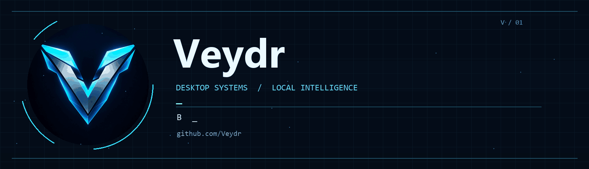
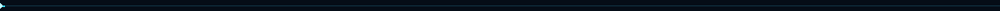
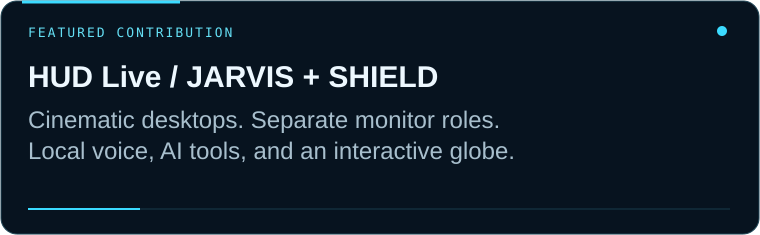
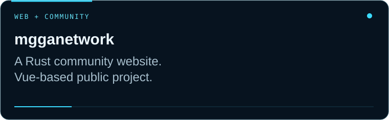
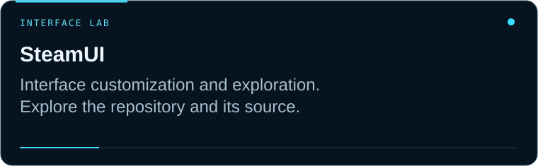
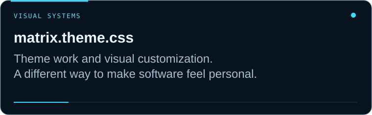
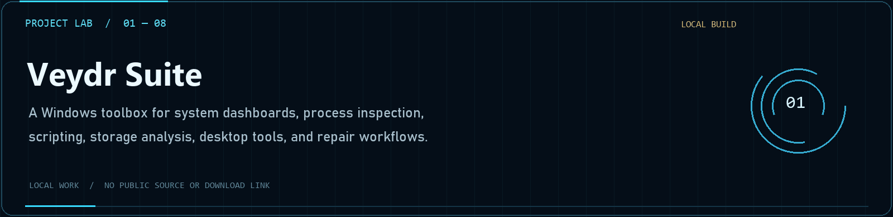
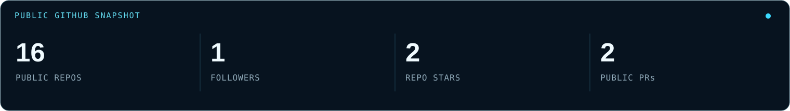
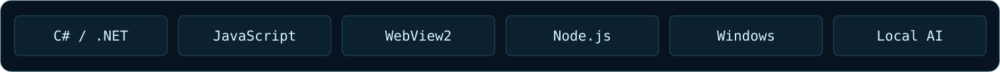
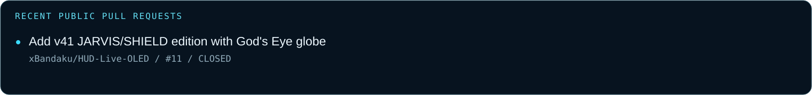

<picture>
  <source media="(prefers-reduced-motion: reduce)" srcset="assets/veydr-banner-static.png" />
  
</picture>

**Building useful tools with a cinematic edge.**

[Projects](https://github.com/Veydr?tab=repositories) · [HUD Live](https://github.com/xBandaku/HUD-Live-OLED) · [Recent contributions](#recent-contributions) · [Stars](https://github.com/Veydr?tab=stars)

## What I'm working on

Windows desktop experiences, local AI tools, browser integrations, hardware controls, and custom interfaces that make everyday workflows feel more personal.

My recent contribution is the **JARVIS / SHIELD edition of HUD Live**: distinct monitor roles, neural voice, local conversation, desktop organization, and God's Eye View inside SHIELD.

## Featured projects

<table>
<tr>
<td width="50%"></td>
<td width="50%"></td>
</tr>
<tr>
<td width="50%"></td>
<td width="50%"></td>
</tr>
</table>

## Project Lab — local builds and experiments

<picture>
  <source media="(prefers-reduced-motion: reduce)" srcset="assets/project-lab-static.png" />
  
</picture>

A selection of work developed locally. These are showcases rather than public releases or download links.

| Project | Development focus | Status |
| --- | --- | --- |
| **Veydr Suite** | Windows dashboards, process tools, scripting, storage, and desktop workflows | Local build |
| **Veydr Galleon** | Standalone GALLEON 100 SD control, LCD keys, dials, lighting, and plugin compatibility | Local build |
| **Open Download Manager** | Segmented downloads, browser integration, and supported media workflows | Local build |
| **DualScreenShare** | Combined dual-monitor sharing with system audio in Equicord | Experimental plugin |
| **PromptPilot** | Local-template prompt enhancement for supported desktop assistants | Local build |
| **Veydr Studio** | Preview-based Windows customization, profile deployment, and rollback tracking | Local build |
| **Veydr OS** | Reproducible customization of a licensed Windows installation image | Build project |
| **Veydr Browser** | Browser customization, profile restoration, and desktop integrations | Local customization |

## GitHub snapshot

Public GitHub data only. Counts reflect the latest generated snapshot; they are refreshed automatically when the profile workflow runs.

## Toolbox

## Current focus

- **Desktop customization** — readable layouts, cohesive themes, and practical controls.
- **Local intelligence** — speech, conversation, and useful everyday actions.
- **Reliable systems** — multi-monitor behavior and recovery that keep the experience steady.

## Recent contributions

[View the merged JARVIS / SHIELD contribution →](https://github.com/xBandaku/HUD-Live-OLED/pull/11)

## Explore and connect

[Browse my public repositories](https://github.com/Veydr?tab=repositories) · [See what I've starred](https://github.com/Veydr?tab=stars) · [HUD Live discussions](https://github.com/xBandaku/HUD-Live-OLED/discussions)

Veydr · Designed around clarity. Inspired by cinematic technology.

